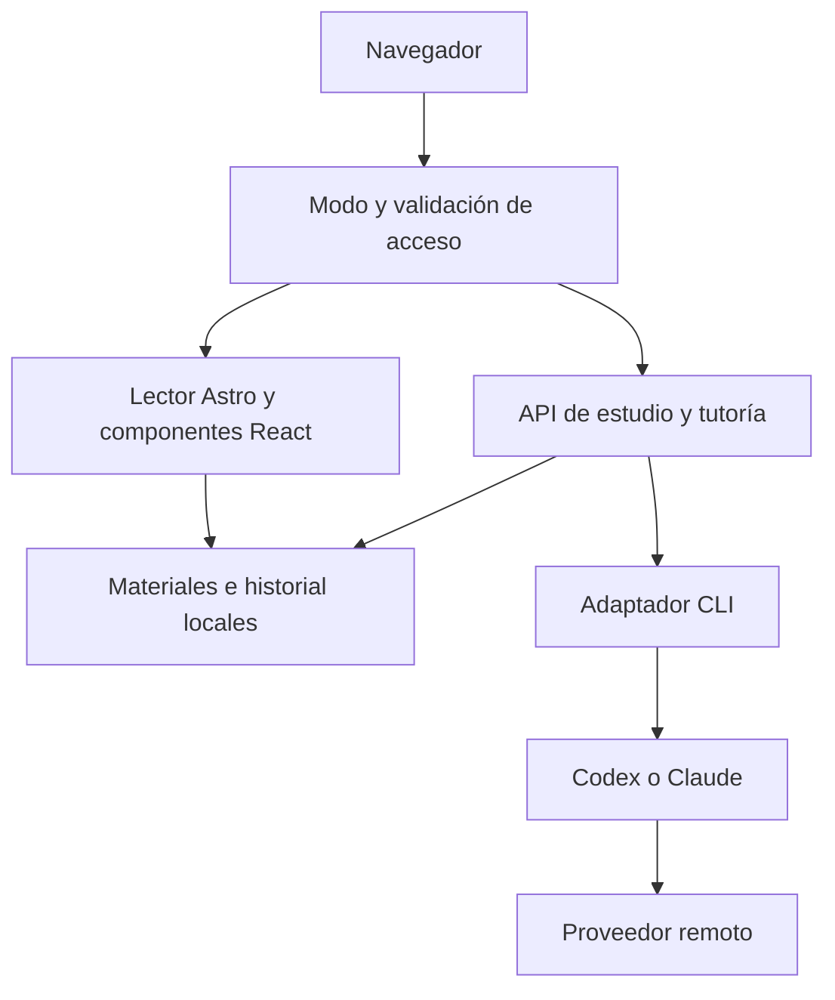

# Arquitectura actual

Describe la implementación inspeccionada el 31 de octubre de 2026, no la arquitectura completa prevista. Requisitos y organización pedagógica: [especificación](product-spec.md). Contratos: [datos y API](data-and-api.md).

## Forma del sistema

Aplicación Astro con renderizado bajo demanda y adaptador Node en modo standalone. React implementa las interacciones de estudio; Tailwind y CSS propio definen una paleta y tipografía para lectura. Button y Dialog siguen patrones de shadcn/ui; Radix aporta comportamiento del diálogo. No existe un servidor Fastify adicional ni una base de datos SQL.

La vista compartida usa el mismo build en otro proceso. Su middleware permite la página de lectura y bloquea las APIs; el render inicial recibe estado vacío en vez de datos personales. Los archivos estáticos de `dist/client` los entrega el adaptador antes del middleware. Por ello nunca deben contener materiales privados ni secretos.

## Mapa del código

| Ruta | Responsabilidad |
| --- | --- |
| `astro.config.mjs` | SSR, Node, React, Tailwind, host/puerto y patrones de host locales |
| `src/pages/index.astro` | Carga del capítulo y estado inicial; pantalla de configuración en caso de error |
| `src/components/Study.tsx` | Lectura, navegación, preferencias, selección, diálogo, notas y actividades |
| `src/components/ui/` | Primitivas visuales Button/Dialog; helpers en `src/lib/utils.ts` |
| `src/styles/global.css` | Temas, tamaños, columnas, responsive, foco y movimiento reducido |
| `src/middleware.ts` | Restricción de host/origen personal; aislamiento global del proceso compartido |
| `src/pages/api/study.ts` | Leer y guardar estado de estudio |
| `src/pages/api/tutor.ts` | Ejecutar una consulta contextual validada |
| `src/server/settings.mjs` | Resolver el directorio privado desde entorno o .env |
| `src/server/access.mjs` | Identificar el modo compartido del proceso |
| `src/server/chapter.mjs` | Leer Markdown, segmentar secciones, sanear HTML, separar actividades y verificar aprobación |
| `src/server/store.mjs` | Acciones de estudio, cola de escritura por proceso y persistencia JSON |
| `src/server/http.mjs` | JSON, validación de cuerpo/origen y mensajes de error públicos |
| `src/server/tutor.mjs` | Contexto mínimo, validación de proveedor, concurrencia y mensajes del tutor |
| `src/runtime/` | Configuración, procesos, parsers oficiales y diagnóstico de los CLI |
| `src/review/` | Contratos, huellas, fuentes, revisión, corrección acotada, aprobación reutilizable e informes |
| `scripts/` | Comandos para servir, compartir, diagnosticar y revisar |
| `tests/` | Unitarias, componentes en DOM simulado e integración HTTP |
| `ops/github/` | Plantillas y documentación de protección de ramas |

## Carga y presentación del contenido

`loadChapter()` busca una ruta fija dentro del directorio privado: `courses/docker/chapters/01-modelo-mental.md`. El contenido se lee en el servidor, no se importa dentro del bundle del cliente al compilar.
`parseChapter()` extrae título y revisión del frontmatter, separa por encabezados `##`, conserva identificadores `{#...}` y crea partes HTML, diagrama o actividad. El Markdown se procesa con marked y sanitize-html. Los bloques `

…
…
` pasan a actividades que requieren intento antes de mostrar feedback. Para `comprobacion` se añade un bloque específico de razonamiento.
El parseo es deliberadamente acotado: no es un parser general de frontmatter/MDX. El id de capítulo y la comprobación son específicos de Docker. El preámbulo anterior al primer `##` no se muestra como cuerpo de sección; la interfaz presenta su encabezado propio.
El HTML saneado se renderiza en React. Mermaid se importa dinámicamente y dibuja con `securityLevel: strict`; existe una alternativa textual en el manuscrito. Las respuestas del tutor se muestran como texto, no como HTML del modelo.

## Estado y reanudación

Las preferencias de aspecto van a localStorage con la clave `understandly-reading`. El resto del estado está en un JSON privado, compartido por los dispositivos que acceden al mismo servidor.
Las modificaciones se expresan como acciones, no como reemplazo completo del JSON enviado por el navegador. Una promesa encadena las escrituras dentro del proceso; cada archivo se reemplaza mediante rename atómico. No es un mecanismo de concurrencia entre procesos.
La posición se guarda por sección tras un debounce de 900 ms. Se reanuda cuando la versión guardada coincide con la actual. Notas e intentos incluyen SHA-256 del manuscrito. Los intentos visibles de la actividad se filtran por versión; las notas antiguas permanecen y se etiquetan.
El ancla de una nota conserva sección, texto seleccionado y versión; todavía no tiene offsets ni reconciliación automática cuando cambia el texto.

## Tutoría

El cliente envía proveedor, modo, selección, pregunta, sección, versión y el historial contextual. El servidor vuelve a cargar el capítulo; no acepta un prompt arbitrario ni una ruta elegida por el navegador.
El prompt incluye la sección sin bloques de soluciones, límites de contexto, índice y conexiones futuras explícitas. No se envía todo el curso. Se permite una consulta simultánea en ese proceso; otra recibe 429. No hay streaming, cola duradera ni reintento automático.
El adaptador ejecuta un binario validado mediante spawn sin shell, en un directorio temporal vacío, con prompt por stdin, límites de salida y timeout. Claude recibe flags de desactivación de herramientas. Codex usa `exec` efímero y sandbox read-only; **la instrucción de no usar herramientas no equivale a una desactivación técnica de todas ellas en Codex**. El proceso no es una frontera de aislamiento frente a todos los archivos del usuario. Ver [runtime](cli-runtime.md).
Los errores expuestos no incluyen stderr, tokens ni entornos. Una pregunta puede fallar y el resto de la experiencia continúa disponible.

## Autoría y revisión editorial

Es un flujo distinto al tutor en vivo. Los comandos operan sobre materiales privados ya preparados y congelan manuscrito, alcance y evidencia. Se validan referencias antes de consultar; después, el JSON del dictamen debe cubrir todos los criterios y fuentes.
El ciclo automático asigna autor y revisor distintos, aplica solo correcciones verificables, conserva antes/después y vuelve a revisar. Un lock por capítulo impide ciclos automáticos simultáneos; el máximo predeterminado es tres rondas. Ante falta de evidencia se detiene para investigar.
La reutilización busca un ciclo aprobado de la misma política, roles, entradas y esquema, contrastando sus snapshots y dictamen. No crea una aprobación nueva ni modifica el contenido. La interfaz acepta registros en cualquiera de las dos asignaciones de roles.
La compatibilidad interna conserva revisión doble como valor predeterminado de `reviewChapter`; el CLI y `autoReviewChapter` eligen explícitamente al revisor único. No asumir que llamar a la función interna equivale a ejecutar el comando CLI.

## Acceso personal y vista compartida

| Aspecto | Personal | Compartido |
| --- | --- | --- |
| Comando | `npm start` | `npm run share` |
| Puerto por defecto | 4321 | 4322 |
| Host por defecto | 127.0.0.1 | 127.0.0.1, para forward en el mismo equipo |
| Host público/proxy | Rechazado | Página de lectura permitida |
| Estado inicial | Datos del estudiante | Vacío, sin leer el JSON del estudiante |
| API | Disponible con validación local/origen | Bloqueada, incluso con Host local |
| Tutoría y escritura | Habilitadas | Desactivadas |
| Autenticación | No implementada | La restricción es funcional, no autenticación del enlace |

El modo compartido se fija globalmente por `scripts/share.mjs` antes de importar el servidor. No se deduce de cabeceras, porque un túnel puede reescribirlas. Los propios handlers vuelven a rechazar APIs en ese modo. La vista contiene las soluciones del material, por lo que no sirve como examen seguro.
No se implementaron acceso remoto autenticado, TLS propio, multiusuario, autorización por curso ni almacenamiento remoto.

## Límites a considerar al ampliar

El lector y los ids de actividad están acoplados a Docker y al orden de los bloques. Generalizar requiere un catálogo y metadatos estables, no solo cambiar una ruta. `Study.tsx` concentra gran parte de la interacción y puede dividirse al crecer.
La aprobación depende de un archivo de alcance que también contiene notas operativas. Cambiar documentación en ese archivo invalida la huella. Debe separarse con una migración y revisión explícitas.
La búsqueda actual puede reutilizar una aprobación coincidente antigua; no implementa revocación por un rechazo posterior ni identidad versionada del prompt como requisito de reutilización. Definir estas reglas antes de convertir el historial en una política editorial más amplia. No borrar informes para resolver una discrepancia.
No hay CI, observabilidad estructurada ni supervisor. Los procesos lanzados durante el desarrollo no garantizan disponibilidad permanente.
