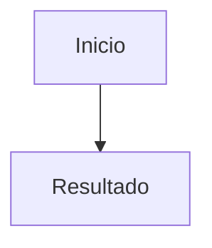

# Datos y API del piloto

Contratos inspeccionados el 31 de octubre de 2026. Implementación actual de un único estudiante y del capítulo `docker-capitulo-01`; no es todavía una API pública estable. Los ejemplos de este documento son ficticios.

## Ubicación y propiedad de los datos

`UNDERSTANDLY_DATA_DIR` se resuelve desde el entorno del servidor, después .env y finalmente `../work/understandly-data`, relativo al directorio desde el que se ejecuta el proyecto. No usar una carpeta dentro de un repositorio Git. El código comprueba ancestros y enlaces simbólicos para las rutas privadas principales.

| Ruta relativa al directorio privado | Contenido |
| --- | --- |
| `courses/docker/chapters/01-modelo-mental.md` | Manuscrito y frontmatter |
| `courses/docker/source-evidence.json` | Extractos de evidencia y referencias |
| `courses/docker/reviews/` | Revisiones individuales congeladas |
| `courses/docker/auto-reviews/` | Ciclos, snapshots, informes y correcciones |
| `courses/docker/revisions/` | Copias históricas preparadas durante la edición del piloto |
| `courses/docker/review-status.json` | Resumen histórico auxiliar; no sustituye la validación de huellas |
| `study/docker-capitulo-01.json` | Notas, intentos y posición del estudiante |

El alcance predeterminado está en `docs/pilots/docker.md`, dentro del repositorio. Los comandos permiten indicar otro alcance, pero la pantalla todavía usa esa ruta fija para comprobar aprobaciones.
No copiar cursos, informes, notas, tokens o respaldos al repositorio público para facilitar la instalación. La ausencia de esos archivos en un clon es esperada.

## Manuscrito

El formato actual espera saltos de línea LF, un frontmatter sencillo y secciones `##` con ids estables:

````markdown
---
id: capitulo-ficticio
revision: 1
status: draft
language: es
title: Ejemplo ficticio de formato
---

## Una idea {#una-idea}

Explicación de ejemplo. [1]



Alternativa textual del diagrama.

<details>
<summary>Feedback de la actividad ficticia</summary>

Explicación reservada hasta registrar un intento.

</details>

## Fuentes

1. https://example.invalid/fuente-ficticia
````

Ese ejemplo ilustra la sintaxis, no evidencia académica ni una plantilla de curso aprobado. El lector actual sigue asignando el id Docker y la ruta fija del piloto, aunque el frontmatter contenga otro id.
La huella `version` de la pantalla es SHA-256 de todos los bytes del Markdown, incluidos metadatos y espacios. Cambiar `status: draft` por `approved` alteraría la versión aprobada; el estado editorial se conserva en registros separados.

## Evidencia editorial

```json
{
  "sources": [
    {
      "id": "1",
      "url": "https://example.invalid/fuente-ficticia",
      "excerpt": "Texto ficticio: no utilizar como fuente real."
    }
  ]
}
```

Cada id es numérico y único, representado como string. Cada fuente necesita URL HTTPS y extracto no vacío. Se permite metadata adicional de procedencia. El manuscrito cita `[1, 2]` y lista `1. https://...`; el preflight exige correspondencia exacta. Un enlace solo no reemplaza un extracto suficiente.
Los revisores no navegan automáticamente esas URLs. Si una afirmación esencial no está respaldada, investigar y ampliar evidencia antes de continuar. No generar extractos atribuidos a fuentes que no se hayan consultado.

## Estado de estudio: schema 1

```json
{
  "schema": 1,
  "notes": [],
  "attempts": [],
  "position": null,
  "visited": []
}
```

`visited` es opcional en archivos anteriores y lista `{section, version}` por sección recorrida. No mide dominio.

| Entidad | Campos guardados |
| --- | --- |
| Nota | `id`, `section`, `version`, `selection`, `question`, `answer`, `createdAt` |
| Intento | `id`, `exercise`, `section`, `version`, `answer`, `assisted`, `createdAt` |
| Posición | `section`, `version`, `updatedAt` |

Ids y fechas se generan en el servidor. Las notas incluyen el fragmento exacto, no offsets. No hay tabla de competencias ni resultados de examen. `assisted` refleja una señal de ayuda registrada por la interfaz, no una prueba exhaustiva de independencia: otras consultas o ayudas fuera de la app no se detectan.
El histórico de intentos se conserva, aunque la interfaz filtra por versión actual. Las notas de versiones anteriores se muestran etiquetadas. No se migran anclas ni se borran datos al cambiar de capítulo.
`readState()` parsea JSON; no implementa un validador completo de esquema ni migraciones. Un archivo inválido produce error y debe respaldarse/diagnosticarse antes de editar; no eliminarlo para ocultar el problema.

## Endpoints

Los endpoints están habilitados solo en el servicio personal. No hay autenticación ni ids de usuario: todos los clientes autorizados a acceder a ese servidor comparten el mismo estado.
Las escrituras requieren `Origin` igual al origen de la petición y `Content-Type: application/json`. El límite de cuerpo es **48000 bytes**; los límites de strings se validan por longitud JavaScript. No hay CORS para un consumidor externo.

### GET /api/study

Devuelve el estado completo del estudiante con `Cache-Control: no-store`. No inicia consultas al modelo. En vista compartida devuelve 403.

### POST /api/study

Acepta una acción y devuelve el estado actualizado. Campos comunes: `type`, `version` y `section`. `version` debe coincidir con la huella actual y la sección debe existir.

| Acción | Campos adicionales | Límites |
| --- | --- | --- |
| `position` | Ninguno | Actualiza la última sección, sin porcentaje de dominio |
| `attempt` | `exercise`, `answer`, `assisted` opcional | Ejercicio existente en esa sección, respuesta 1–8000 caracteres |
| `note` | `selection`, `question`, `answer` | Selección 1–3000, pregunta 1–2000, respuesta 1–16000 caracteres |

```json
{
  "type": "attempt",
  "version": "HUELLA-SHA256-ACTUAL",
  "section": "una-idea",
  "exercise": "una-idea-1",
  "answer": "Razonamiento ficticio del estudiante.",
  "assisted": false
}
```

El ejemplo requiere reemplazar ids y huella por los de un capítulo real. No hay acciones de borrado o edición. Las notas enviadas por el cliente se guardan como texto: no constituyen una certificación de autoría del modelo ni de exactitud.

### POST /api/tutor

```json
{
  "provider": "codex",
  "mode": "explain",
  "version": "HUELLA-SHA256-ACTUAL",
  "section": "una-idea",
  "selection": "Fragmento ficticio seleccionado.",
  "question": "¿Puedes explicarlo con otro ejemplo?",
  "history": []
}
```

- `provider`: `codex` o `claude`.
- `mode`: `explain` para duda puntual, `reframe` para una explicación alternativa, `summary` para resumir `history`, que entonces es obligatorio; `question` se ignora.
- `selection`: texto no vacío, máximo 3000 caracteres. El diagrama se consulta como estructura textual.
- `question`: texto no vacío, máximo 2000 caracteres.
- `history`: opcional; el servidor toma como máximo los cuatro últimos intercambios. Cada uno se limita a 2000 caracteres de pregunta y 6000 de respuesta.

El servidor verifica sección y versión, omite `<details>` del contexto, limita la sección a 12000 caracteres y añade el índice y conexiones planificadas. La respuesta exitosa es `{"answer":"…","provider":"codex"}`; la respuesta se limita a 16000 caracteres. No se persiste la conversación completa automáticamente: solo se guarda como nota el resumen que el lector aprueba.
El endpoint no califica intentos. Pedir una reformulación no cambia los archivos del curso. El navegador no puede elegir un comando, una ruta local ni el binario ejecutado.

## Errores HTTP

| Estado | Uso actual |
| --- | --- |
| 200 | Lectura, guardado o respuesta del tutor exitosos |
| 400 | Datos inválidos; errores normalizados de consulta al CLI |
| 403 | Modo compartido, host/origen no permitido o formato de escritura no permitido |
| 409 | Versión de capítulo obsoleta; recargar antes de continuar |
| 413 | Cuerpo de solicitud demasiado grande |
| 429 | Ya existe una consulta al tutor en ese proceso |
| 500 | Fallo no controlado de lectura/guardado, con mensaje público fijo |
| 503 | Página inicial sin materiales o estado legible |

Los handlers usan `{"error":"mensaje controlado"}`. Algunas respuestas directas del middleware personal son texto. No depender de que todos los 403 tengan JSON. La vista compartida rechaza APIs incluso si un cliente falsifica Host local; solo la página raíz llega a SSR, además de los recursos estáticos entregados por el adaptador.

## Aprobaciones

Un `manifest.json` contiene huellas de contenido, alcance, evidencia, prompt y esquema, política, revisores y dictámenes. Un `cycle.json` agrega rondas, autor/revisor, resultado y referencias a snapshots. `report.md` es la explicación legible.
No editar un dictamen para que pase. Una aprobación requiere validación estructural, criterios y fuentes completos; en el ciclo automático también deben coincidir las entradas actuales. Los códigos de revisión están descritos en [chapter-review.md](chapter-review.md).
No confundir `approved` con publicación, conformidad WCAG o competencia del estudiante. No confiar únicamente en `review-status.json` ni en un campo del frontmatter.

## Respaldo y restauración manual

No existe exportador en UI. Para un respaldo coherente, detener el único servidor escritor y los ciclos editoriales activos; copiar el directorio privado completo a una ubicación privada, y respaldar .env por separado en un mecanismo seguro. No incorporar esa copia a Git.
Para restaurar: detener escritores, conservar una copia del estado actual, restaurar materiales junto con evidencia/historial y el JSON de estudio, configurar el directorio y arrancar desde la raíz. Comprobar notas, intentos, aprobación por huellas y reanudación. Restaurar un tag de código no restaura datos.
Antes de añadir migraciones, decidir compatibilidad y probar con copias ficticias. No cambiar schema ni descartar campos de usuarios sin una migración revisable.
