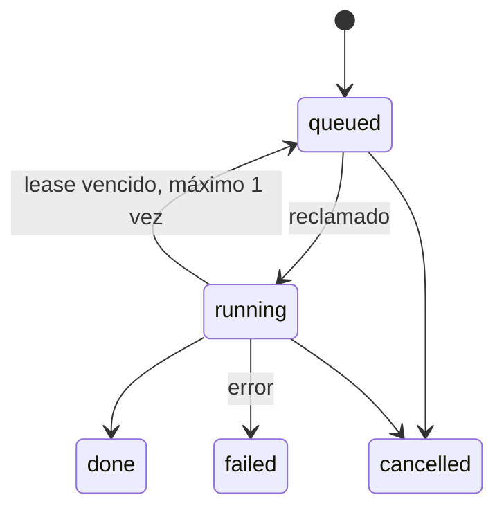
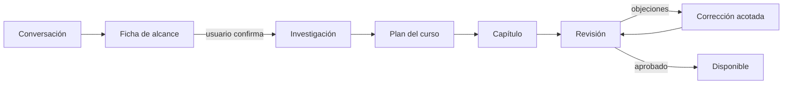
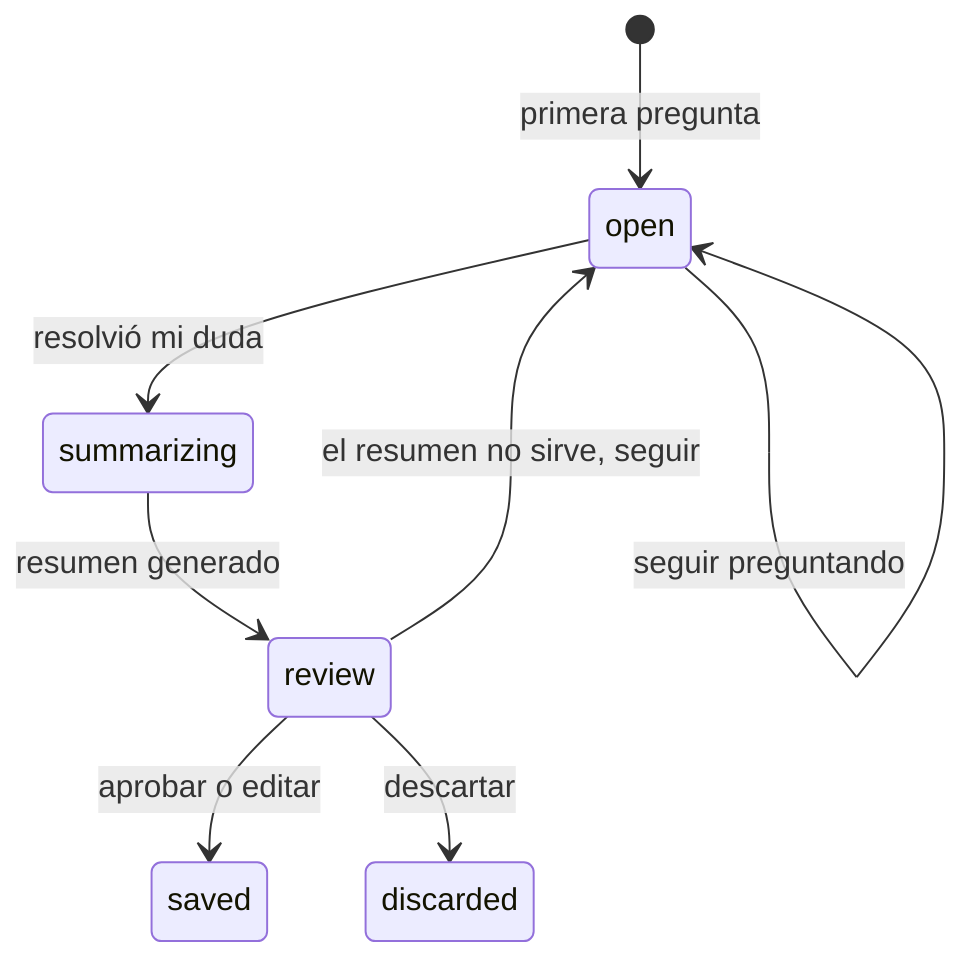

# Diseño de la plataforma

Estado: **propuesta en revisión**, 31 de octubre de 2026. Detalla cómo funciona lo definido en el [plan de plataforma](platform-plan.md), cuyos criterios E1–E11 siguen siendo la medida de cierre. Las propuestas no son decisiones hasta que el usuario las apruebe.

## Componentes

| Pieza | Dónde corre | Credenciales | Responsabilidad |
| --- | --- | --- | --- |
| Web Astro | Vercel | Clave pública de Supabase y sesión del usuario | Páginas y lectura; nunca ejecuta IA |
| Supabase | Nube | Propias | Auth, Postgres con RLS, Storage privado y Realtime |
| Worker | Mac del propietario | `service_role`, sesiones de Claude y Codex | Reclamar trabajos, ejecutar CLI y validar resultados |

**Regla central:** ni `service_role` ni las sesiones de IA existen en Vercel. Si la web se compromete, el atacante queda limitado por RLS a la sesión que tenga y no obtiene acceso a los CLI.

El worker corre bajo un **usuario de macOS dedicado**, con launchd para arrancar solo. Ese usuario tiene sus propias sesiones de CLI y no puede leer la carpeta personal. No exige Docker y aísla también a Codex, que hoy puede leer archivos. Se valida con la prueba E11.3.

## Rutas

| Ruta | Pantalla |
| --- | --- |
| `/login` | Acceso |
| `/` | Biblioteca del login: cursos, estado y siguiente paso |
| `/conversaciones` | Lista de conversaciones vivas |
| `/conversaciones/[id]` | Conversación de creación y cursos que produjo |
| `/cursos/[id]` | Plan del curso, estado, competencias y cuaderno completo |
| `/cursos/[id]/capitulos/[n]` | Lector actual, sin cambios en modo lector |

Middleware: toda ruta exige sesión salvo `/login`. La vista compartida de solo lectura (`npm run share`) se retira de la nube; solo se conserva si sigue haciendo falta en local.

## Cola de IA

El navegador nunca envía un prompt. Llama a la RPC `enqueue_job(kind, refs, input)`, que comprueba la propiedad de cada referencia. El worker reconstruye el prompt desde la base con su plantilla versionada.

| `kind` | Rol | Herramientas |
| --- | --- | --- |
| `conversation_turn` | Autor | Ninguna |
| `tutor_turn`, `tutor_summary` | Tutor | Ninguna |
| `research` | Autor | Solo búsqueda y lectura web |
| `plan_course`, `write_chapter`, `fix_chapter` | Autor | Ninguna |
| `review_chapter` | Revisor | Ninguna |
| `evaluate_attempt` | Revisor | Ninguna |

- Reclamo con `FOR UPDATE SKIP LOCKED`. Lease de 2 minutos renovado por heartbeat, para recuperarse si la Mac se duerme.
- Se ejecuta **un trabajo a la vez**, con prioridad para tutor sobre generación: una duda no espera a que termine un capítulo. Límite: 20 trabajos en cola por login.
- La interfaz sigue el trabajo por Realtime. Las respuestas llegan completas; el streaming queda fuera de la primera versión.
- La tabla `worker_status` guarda el último latido. Si tiene más de 90 s, la interfaz avisa de que la IA está desconectada y que la petición queda en cola. Leer y tomar notas sigue funcionando.
- Sin reintentos ciegos: `USAGE_LIMIT` pausa la cola y lo muestra; los demás errores quedan en `failed`, con un mensaje seguro y reintento manual.

## Conversación y generación

1. **Conversación.** El skill `skills/course-builder/` conduce la charla con pocas preguntas. Cada turno es `conversation_turn`, con resumen acumulado más los últimos mensajes, para no reenviar todo y agotar el límite de 256 KiB del runtime.
2. **Ficha de alcance.** Cuando hay datos suficientes, el modelo propone una ficha con esquema JSON: objetivo, profundidad, exclusiones, competencias, criterios, prerrequisitos y modalidad. Se muestra como tarjeta editable. Nada se genera sin confirmación, y la ficha se versiona.
3. **Investigación.** Ver la sección de fuentes.
4. **Plan.** Lista de capítulos, con competencias y dependencias.
5. **Capítulo y revisión.** Reutiliza `src/review/`: versión congelada, rúbrica, máximo de 3 rondas y parada por falta de evidencia.

La conversación sigue viva. Desde ella se puede pedir otro curso, un satélite (`parent_course_id`) o más profundidad, cada uno con su nueva ficha. Borrarla no borra los cursos.

**Generación progresiva (acordado):** se genera plan y capítulo 1. El siguiente se encola al completar el anterior o al pedirlo. Evita gastar cuota en capítulos que quizá no se lean.

**Desbloqueo (acordado):** secuencial por defecto, ajustable a libre en cada curso. «Generado» y «desbloqueado» son estados separados, como dice la especificación. Propuesta por confirmar: un capítulo se completa al recorrer sus secciones y guardar un intento en cada actividad obligatoria; acertar no es requisito.

## Fuentes: hueco detectado

El piloto se revisó con evidencia preparada a mano, y el autor corre sin herramientas. Generar sin más produciría citas inventadas, algo que `AGENTS.md` prohíbe. Por eso:

- El trabajo `research` habilita solo búsqueda y lectura web, y devuelve `{url, excerpt}` por afirmación clave.
- El worker descarga cada URL y **comprueba por código que el extracto aparece en la página**. Sin coincidencia, la fuente se rechaza. No depende de que un modelo diga la verdad.
- Solo Claude tiene esta tarea, porque sus herramientas se pueden restringir por flags.
- Los materiales adjuntos cuentan como fuente, identificados como del usuario.
- Sin evidencia suficiente, el ciclo se detiene y lo informa, igual que hoy.

Los extractos validados se guardan en `sources` y el preflight de `src/review/references.mjs` se reutiliza.

## Contenido y versiones

- `chapter_versions` es inmutable: Markdown, SHA-256, autor, revisor y estado (`draft`, `in_review`, `approved`, `rejected`). `chapters.current_version_id` apunta a la vigente.
- Aprobación ligada a la huella de contenido, alcance y evidencia. Al vivir la ficha en la base, desaparece el acoplamiento con `docs/pilots/docker.md`.
- Ids estables escritos por el autor, `{#id}` en secciones e `{#id}` en actividades; el validador rechaza el capítulo si faltan o se repiten. Resuelve la dependencia del orden.
- `parseChapter()` se conserva, sin los textos de Docker: título, temario y descripciones salen de la base.

## Tutor

- Tabla `tutor_threads`, con mensajes, curso, sección, versión y selección.
- Toda conversación aparece en el cuaderno como **pregunta abierta** y se puede retomar. Es lo que une notas y preguntas en un solo sitio.
- Al aprobar, el resumen editado pasa a nota anclada y la conversación queda enlazada.
- Al descartar, la conversación se borra por completo, sin deshacer. Se pide confirmación.
- Si consultar al tutor afecta a una actividad, el intento se marca como asistido, como hoy.

## Cuaderno y paneles

- Panel derecho y pestaña en `/cursos/[id]`, filtrables por sección y estado (abierta o nota). Por curso y login.
- Editar y borrar entradas propias. Las notas de versiones anteriores se conservan etiquetadas.
- Paneles: dos booleanos en `localStorage`, aplicados como columnas del grid CSS. Los botones se añaden a la barra superior con `aria-expanded`.
- Modo lector: mantiene su comportamiento. Al salir se recupera el estado previo de cada panel.

## Estado, competencias y repasos

| Dimensión | Fuente | Cómo se muestra |
| --- | --- | --- |
| Recorrido | Secciones vistas y actividades guardadas | «Capítulo 2 de 5, sección 3», siguiente paso |
| Competencia | `evidence` | Por competencia: sin evidencia, con ayuda, independiente |

No hay porcentaje de dominio global. Las modalidades sin evaluación muestran solo recorrido. La retención a largo plazo no se mide: el repaso final valida la competencia al terminar el capítulo, no que se recuerde tiempo después.

- `evaluate_attempt` compara una respuesta abierta con los criterios y **propone** feedback; el estudiante puede cuestionarlo. Solo una evidencia sin ayuda cuenta como independiente.
- **Repaso final (acordado):** cierra cada capítulo con una explicación muy condensada por competencia, seguida de preguntas puntuales que la validan. Forma parte del manuscrito y se revisa con él. Sin calendario, avisos ni repasos pendientes: no depende de la frecuencia de uso.
- Propuesta por confirmar: fallar una pregunta del repaso muestra la explicación y permite reintentar; no impide desbloquear el siguiente capítulo, pero la competencia queda sin validar.

## Ingesta

Primera versión: Markdown, texto y PDF con texto seleccionable, hasta 20 MB, en un bucket privado de Storage. El worker extrae el texto antes de enviarlo y la ficha indica qué cubre el material y qué falta. Imágenes y OCR se añaden después; requieren decidir formatos y dar lectura de archivos al modelo.

## Migración del piloto

Un script ejecutado una vez lee `../work/understandly-data` y crea el curso Docker en el login del propietario, con su capítulo, evidencia y referencia a la aprobación. No hay notas ni intentos que migrar; solo una posición. El directorio local no se borra y sirve de respaldo.

## Pruebas

- RLS con dos logins sobre una Supabase local, sin secretos reales.
- Worker con CLI ficticio, como en `tests/study-http.integration.mjs`: lease vencido, cancelación, cola pausada y validación de extractos.
- Prueba real, con fecha, de un curso de ejemplo completo: conversación, ficha, investigación, capítulo, revisión y estudio.

## Por verificar antes de implementar

- Límites actuales de los planes gratuitos de Vercel y Supabase, incluida la pausa por inactividad.
- Flags exactos de Claude para permitir solo búsqueda y lectura web.
- Términos de OpenAI para este uso.
- Comportamiento de los CLI bajo un usuario de macOS dedicado.
