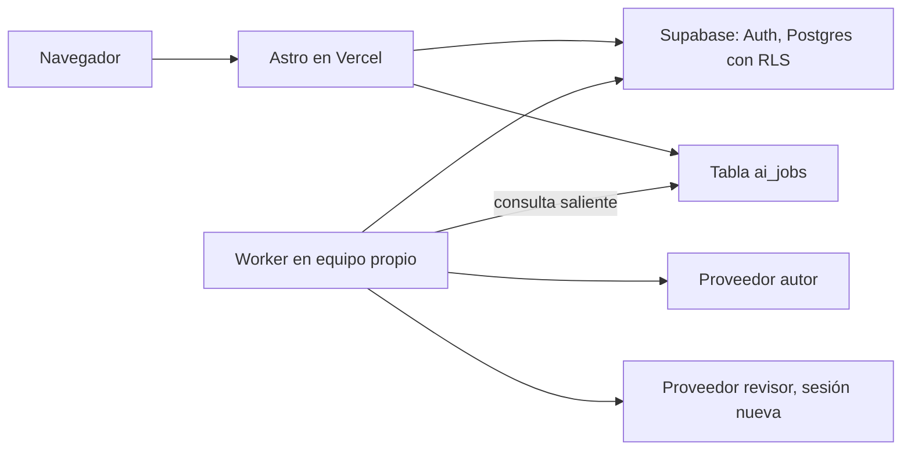

# Plan de plataforma compartida

Estado: **propuesta en revisión**, 31 de octubre de 2026. Recoge los requisitos del usuario tras el primer uso del piloto y los convierte en criterios de evaluación. No autoriza por sí sola un despliegue. Sustituye al orden de [la hoja de ruta](roadmap.md) cuando se apruebe.

## Decisiones del usuario

- La web y los datos estarán alojados, probablemente en Vercel con Supabase, para uso personal desde varios dispositivos, con varios logins y una biblioteca aislada por login, activos al mismo tiempo. Claude y Codex corren en un equipo propio, con la cuenta del propietario. Los cursos compartidos entre logins quedan aplazados.
- Codex y Claude se mantienen como proveedores: uno genera y otro revisa, en sesiones separadas.
- No se usará API facturable de Anthropic ni de OpenAI.
- Los cursos nacen de una conversación dentro de la plataforma, con un skill cargado por defecto.
- Modo lector: no se toca.
- Importar y exportar quedan fuera por ahora.

Cambios respecto a decisiones vigentes, que deben registrarse al aprobar este plan:

| Decisión | Cambio |
| --- | --- |
| D04 | Materiales y progreso pasan de locales a una base alojada; siguen fuera del repositorio público |
| D05 | Los CLI siguen en un equipo propio, pero reciben trabajos de una cola remota |
| D10 y AGENTS.md | El alcance «no desplegar el servicio personal» debe actualizarse antes de publicar |

## Decisión D-A: credencial de IA

**Elegido:** worker saliente en un equipo propio con Claude y Codex, sin puerto abierto ni túnel. Consulta los trabajos en la cola, los ejecuta y publica el resultado. Si el equipo se apaga, los trabajos esperan; lectura, notas y progreso siguen disponibles. Cada titular es responsable del uso de su cuenta conforme a los términos del proveedor. Antes del worker, Codex debe aislarse sin acceso a los archivos del equipo.

Análisis previo:

La [política de Claude Code](https://code.claude.com/docs/en/legal-and-compliance) dice que los desarrolladores de productos o servicios deben usar API key, que no pueden enrutar peticiones con credenciales de planes Free, Pro, Max o Ultra en nombre de sus usuarios, ni recoger, guardar o intermediar tokens de sesión de Claude.ai. Ejecutar Claude Code en servicios alojados exige los términos comerciales y que cada usuario final se autentique con su propia credencial. La [autenticación](https://code.claude.com/docs/en/authentication) presenta `CLAUDE_CODE_OAUTH_TOKEN` para CI y scripts. Anthropic se reserva actuar sin aviso previo.

Por tanto, un único token de suscripción en un secret que atienda a dos personas desde una web es contrario al texto vigente, y arriesga la cuenta que lo emitió. La interpretación final corresponde a Anthropic.

| Opción | Cumple el texto | Costo | Cambia |
| --- | --- | --- | --- |
| A. Worker propio: la web encola trabajos y cada persona ejecuta Claude Code con su propia sesión, en su equipo | Más defendible; confirmar con Anthropic | Sin API; cada uno necesita plan y equipo encendido para usar la IA | La IA no corre en la nube, la lectura sí |
| B. API key en secret, usada por sus propios usuarios autorizados | Sí, caso permitido expresamente | De pago por uso; limitable con tope mensual | Nada en la arquitectura; es la más simple |
| C. Pedir aclaración escrita a Anthropic para este uso de dos personas | Depende de la respuesta | Ninguno | Plazo incierto |
| D. Token único en la nube | No | Sin API; riesgo de suspensión | Decisión del titular de la cuenta; no recomendada |

Todo el código de IA pasa por `runtime.ask()`, así que cambiar de opción no afecta al resto del sistema.

Codex: la [documentación de OpenAI](https://developers.openai.com/codex/auth) recomienda API key para automatización y advierte contra ejecutarlo en entornos públicos o no confiables. Sus términos no pudieron leerse de forma automática; queda como verificación pendiente.

## Arquitectura propuesta

- Astro se conserva; cambia el adaptador Node por el de Vercel.
- Toda operación de IA es un trabajo asíncrono: la web crea el registro y la interfaz sigue su estado. Una generación no cabe de forma fiable en una petición HTTP.
- La conversación se guarda en Postgres y se envía como contexto explícito. No se depende de sesiones en disco del CLI.
- El revisor recibe solo versión congelada, alcance y evidencia; nunca la conversación del generador.
- `src/review/` se reutiliza con sus roles actuales: Codex autor y Claude revisor por defecto.
- El skill vive versionado en `skills/course-builder/` y el servidor lo inyecta en cada conversación de generación, junto con su versión registrada.

### Modelo de datos inicial

| Tabla | Propósito | Visibilidad |
| --- | --- | --- |
| `profiles` | Usuario y rol | Propio |
| `courses`, `chapters` | Curso y versiones de capítulo | Propietario o miembros |
| `course_members` | Miembros, ritmo `own` o `together` | Miembros |
| `conversations`, `messages` | Conversaciones de generación, vivas hasta borrarse | Solo su dueño |
| `conversation_courses` | Una conversación produce N cursos; `parent_course_id` en cursos para satélites | Solo su dueño |
| `notes` | Cuaderno por curso y persona, con pregunta, resumen y ancla | Solo su dueño |
| `progress`, `attempts` | Posición, secciones completadas e intentos por persona | Solo su dueño; el estado resumido, a los miembros |
| `competencies`, `evidence` | Competencias y evidencias | Por persona |
| `ai_jobs` | Cola, estado, costo de turnos y errores | Solo su dueño |

## Criterios de evaluación

Cada punto se da por cumplido solo con una prueba real, registrada con fecha.

### E1 · Cuentas y aislamiento

- E1.1 Solo entran logins creados por el propietario; no hay registro abierto.
- E1.2 Sin sesión válida no se lee ni escribe ningún dato, y ningún login accede a datos de otro, ni llamando a la API directamente. Prueba automatizada contra RLS con dos logins.
- E1.3 Cada login retoma su posición, notas e intentos desde cualquier dispositivo.
- E1.4 Dos logins activos a la vez no se interfieren: sus trabajos de IA hacen cola sin mezclarse.

### E2 · Biblioteca y cursos compartidos

Solo E2.1 aplica ahora, sin la separación entre personales y compartidos. E2.2 a E2.5 quedan aplazados con la fase 5.

- E2.1 Cada persona ve sus cursos personales y los compartidos, separados.
- E2.2 Compartir un curso no comparte notas, intentos ni conversaciones.
- E2.3 Con ritmo `own`, cada persona desbloquea según su avance.
- E2.4 Con ritmo `together`, el siguiente apartado se abre cuando ambas personas completan el anterior, y cada una ve qué falta y de quién. Regla por confirmar.
- E2.5 Dejar de compartir conserva los datos de cada persona.

### E3 · Conversación y generación

- E3.1 Crear un curso empieza por una conversación en la plataforma, con el skill cargado sin acción del usuario.
- E3.2 Antes de generar, el usuario confirma alcance, competencias, criterios, prerrequisitos y modalidad, según la [especificación](product-spec.md).
- E3.3 Cerrar y volver retoma la misma conversación; sigue viva tras terminar el curso.
- E3.4 Desde una conversación se pueden crear otro curso o un satélite vinculado al de origen.
- E3.5 Borrar una conversación la elimina tras confirmar y no borra los cursos ya creados.
- E3.6 Una conversación de una persona nunca es visible para otra.
- E3.7 Un fallo de generación es recuperable y no pierde la conversación.

### E4 · Revisión

- E4.1 El revisor corre en sesión nueva, sin historial del generador; se registra en cada dictamen.
- E4.2 Ningún capítulo se muestra como revisado sin dictamen válido de esa versión.
- E4.3 Se mantienen rúbrica, huellas, límite de rondas y parada por falta de evidencia.
- E4.4 La interfaz indica qué proveedor fue autor y cuál revisor de cada versión.

### E5 · Cuaderno

- E5.1 Existe un cuaderno por curso y persona, con notas y preguntas en un solo lugar.
- E5.2 Cada entrada conduce a su fragmento y muestra si procede de otra versión.
- E5.3 Se pueden editar y borrar entradas propias.

### E6 · Paneles

- E6.1 Índice y cuaderno se abren y cierran por separado, de forma manual, fuera del modo lector.
- E6.2 El estado se recuerda por dispositivo y funciona con teclado.
- E6.3 El modo lector se comporta exactamente igual que antes. Prueba de regresión.

### E7 · Estado del curso

- E7.1 Biblioteca y lector muestran dónde va cada persona: recorrido, actividades hechas y siguiente paso.
- E7.2 Recorrido y competencia validada se muestran por separado. La retención a largo plazo no se mide ni se afirma.
- E7.3 Las modalidades sin evaluación no muestran 0 % de dominio.

### E8 · Tutor conversacional

- E8.1 Prueba real: pregunta y seguimiento con la IA desde la pantalla. Sigue pendiente desde el piloto.
- E8.2 Cada conversación puede cerrarse con «resolvió mi duda» o continuar con «seguir preguntando».
- E8.3 Al resolver, se genera un resumen que el lector aprueba para guardarlo como nota, o descarta. Sin aprobación no se guarda nada.
- E8.4 Descartar no bloquea ni deja rastro en el cuaderno.

### E9 · Competencias y repasos

- E9.1 Cada competencia registra evidencia, ayuda usada y fecha.
- E9.2 Cada capítulo termina con un repaso final: explicación muy condensada por competencia y preguntas puntuales que la validan. Sin calendario ni avisos.
- E9.3 Leer o guardar un intento no cuenta como dominio.

### E10 · Ingesta

- E10.1 Se pueden adjuntar materiales a una conversación; el sistema indica qué cubren y qué falta.
- E10.2 Materiales incompletos no se presentan como currículo oficial completo.
- Formatos y OCR por acordar.

### E11 · Seguridad y operación

- E11.1 Las credenciales de IA viven solo en el equipo del worker; una prueba comprueba que no aparecen en el bundle, la base ni las respuestas. El worker no abre puertos de entrada.
- E11.2 La clave `service_role` de Supabase nunca llega al navegador.
- E11.3 Generación y tutor no pueden leer archivos del equipo ni ejecutar órdenes contenidas en los materiales. Se demuestra con un documento de prueba malicioso en ambos proveedores.
- E11.4 Hay límite de trabajos por persona y un tope global, para no agotar la cuota.
- E11.5 Los registros no guardan tokens, prompts ni contenido de cursos.
- E11.6 Base con respaldo automático verificado por una restauración de prueba.

## Fases

| Fase | Entrega | Criterios | Depende de |
| --- | --- | --- | --- |
| 0 | Subir el trabajo a GitHub y respaldar datos privados | Integración según [versionado](versioning.md) | Nada |
| 1 | Mejoras del lector en local: paneles, cierre del tutor con resumen, estado | E6, E8, E7.1 | Nada |
| 2 | Supabase, cuentas, biblioteca y catálogo; migrar el capítulo Docker | E1, E2.1, E2.2, E5, E11.2, E11.6 | Proyecto Supabase |
| 3 | Worker saliente, cola de IA y aislamiento de Codex | E11 | Fase 2 |
| 4 | Conversación, skill, generación y revisión | E3, E4 | Fase 3 |
| 5 | Aplazada: cursos compartidos y ritmos | E2.2 a E2.5 | Decidir varios usuarios |
| 6 | Competencias y repaso final | E7.2, E7.3, E9 | Fase 4 |
| 7 | Ingesta | E10 | Definir formatos |

El piloto solo tiene una posición guardada, sin notas ni intentos, de modo que migrar es casi gratis. Conviene además corregir ahora los ids de actividad dependientes del orden.

## Preguntas abiertas

1. Confirmar los términos de OpenAI para este uso.
2. Ritmo `together`: ¿se exige completar lectura o también actividades? Propuesta: lo definido por el curso, con lectura y actividades obligatorias por defecto.
3. ¿Se puede ver qué sección lleva la otra persona? Propuesta: sí en cursos compartidos, solo el estado.
4. ¿Las notas pueden compartirse voluntariamente? Propuesta: no por ahora.
5. ¿Quién edita un curso compartido? Propuesta: quien lo creó; los cambios afectan a ambos y conservan el historial.
